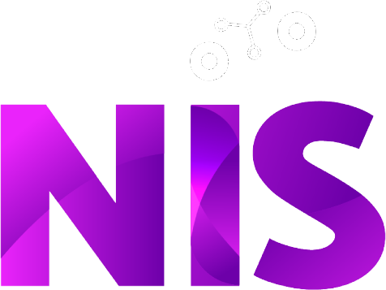

```{=html}
<!--
  CÓMO EDITAR ESTA FICHA
  · El texto se edita acá, en Markdown. El diseño está en ficha.css.
  · Cada bloque ::: {.fi-...} es una caja del diseño. No borrar las líneas ::: que abren y cierran cada caja.
  · Para imprimirla o guardarla como PDF: abrir la página en el navegador > Imprimir > A4, con "gráficos de fondo" activado.
-->
```

:::::::::::::::::::::::::::::: fi-ficha
:::: fi-header
::: fi-header-text
[Ficha · Seis preguntas para proyectos tecnológicos]{.fi-eyebrow}

[Muy lindo el dashboard…]{.fi-title} [¿y ahora qué hago con esto?]{.fi-title .fi-title-accent}

Un pedido tecnológico no es necesariamente un diagnóstico del problema. Estas preguntas sirven antes, durante y después del desarrollo para encontrar lo que hay detrás del pedido y aumentar las chances de que la solución se use.
:::

{.fi-logo fig-alt="Logo del Núcleo de Innovación Social"}
::::

::::::::::::::::::::: fi-grid
::::: fi-q
[1]{.fi-num}

[¿Qué problema intentamos resolver?]{.fi-q-title}

Intentá describirlo sin nombrar la herramienta que se pidió. Los pedidos suelen llegar en el idioma de la solución.

::: fi-ex
**Ejemplo:** "monitorear el programa" escondía dos problemas distintos: decidir cosas adentro y rendir cuentas a quien financia.
:::

::: fi-alerta
**Alerta:** el objetivo del proyecto es el nombre del producto.
:::
:::::

::::: fi-q
[2]{.fi-num}

[¿Quién lo necesita y a quién afecta?]{.fi-q-title}

Pensá en quienes lo van a usar, en quienes toman decisiones y en las personas a las que les cambia el trabajo.

::: fi-ex
**Ejemplo:** el tablero dependía de datos que las referentes de cada espacio cargaban fuera de horario, y nadie lo había contado como trabajo.
:::

::: fi-alerta
**Alerta:** quien carga, usa o cambia su trabajo no estuvo en ninguna reunión.
:::
:::::

::::: fi-q
[3]{.fi-num}

[¿Qué tendría que cambiar para decir que funcionó?]{.fi-q-title}

Buscá un resultado que se pueda observar. Entregar el software no demuestra que se haya resuelto el problema.

::: fi-ex
**Ejemplo:** no alcanza con "tener el tablero". El resultado es que se llame a tiempo a las familias de quienes dejaron de venir.
:::

::: fi-alerta
**Alerta:** "funcionó" quiere decir "está entregado" o "la demo salió bien".
:::
:::::

::::: fi-q
[4]{.fi-num}

[¿Qué sabemos y qué estamos suponiendo?]{.fi-q-title}

Separá la evidencia de las hipótesis y de lo que todavía hay que investigar.

::: fi-ex
**Ejemplo:** suponer que los datos existen y se pueden usar, o que un número (como la asistencia) mide por sí solo si algo funciona.
:::

::: fi-alerta
**Alerta:** nadie vio los datos y ya hay mockups.
:::
:::::

::::: fi-q
[5]{.fi-num}

[¿Qué pasa después de la entrega?]{.fi-q-title}

Mantenimiento, responsables, recursos, uso y evaluación. ¿Cuándo se mira, quién lo abre y qué hace con lo que ve?

::: fi-ex
**Ejemplo:** en vez de inventar un ritual nuevo, mirarlo diez minutos en una reunión mensual que ya existe.
:::

::: fi-alerta
**Alerta:** quien lo mantiene es un nombre propio, no un rol.
:::
:::::

::::: {.fi-q .fi-cross}
[+]{.fi-num}

[¿A quién nos falta preguntarle?]{.fi-q-title}

Esta pregunta atraviesa a todas las demás. Distintos conocimientos ven partes distintas del problema.

::: fi-ex
**No siempre** hace falta un equipo interdisciplinario completo. A veces alcanza con media hora con quien carga los datos o una llamada a alguien que conoce el territorio.
:::

::: fi-alerta
**Alerta:** todas las respuestas vienen de la misma persona o del mismo lugar.
:::
:::::
:::::::::::::::::::::

::::: fi-uso
::: fi-uso-caja
[Cómo usarla sin sumar burocracia]{.fi-uso-title}

No hace falta responder todo en profundidad. Preguntate: **¿cuál de estas, si la respondemos mal, nos hace tirar el proyecto?** Esa es la que vale la pena investigar. Las demás pueden ser una conversación de diez minutos.
:::

::: fi-uso-caja
[No es una lista para archivar]{.fi-uso-title}

Diagnosticar, diseñar, implementar y evaluar se pisan y se vuelve para atrás. Las respuestas son hipótesis: **revisalas durante todo el proyecto.**
:::
:::::

::::: fi-pie
::: fi-pie-org
**Núcleo de Innovación Social**\
nucleodeinnovacionsocial.com.ar
:::

::: fi-pie-evento
Charla en FOCO · Foro de la Comunidad Informática · 28 de noviembre de 2026\
Los ejemplos provienen de un caso ficticio. Usala, compartila y adaptala.
:::
:::::
::::::::::::::::::::::::::::::
